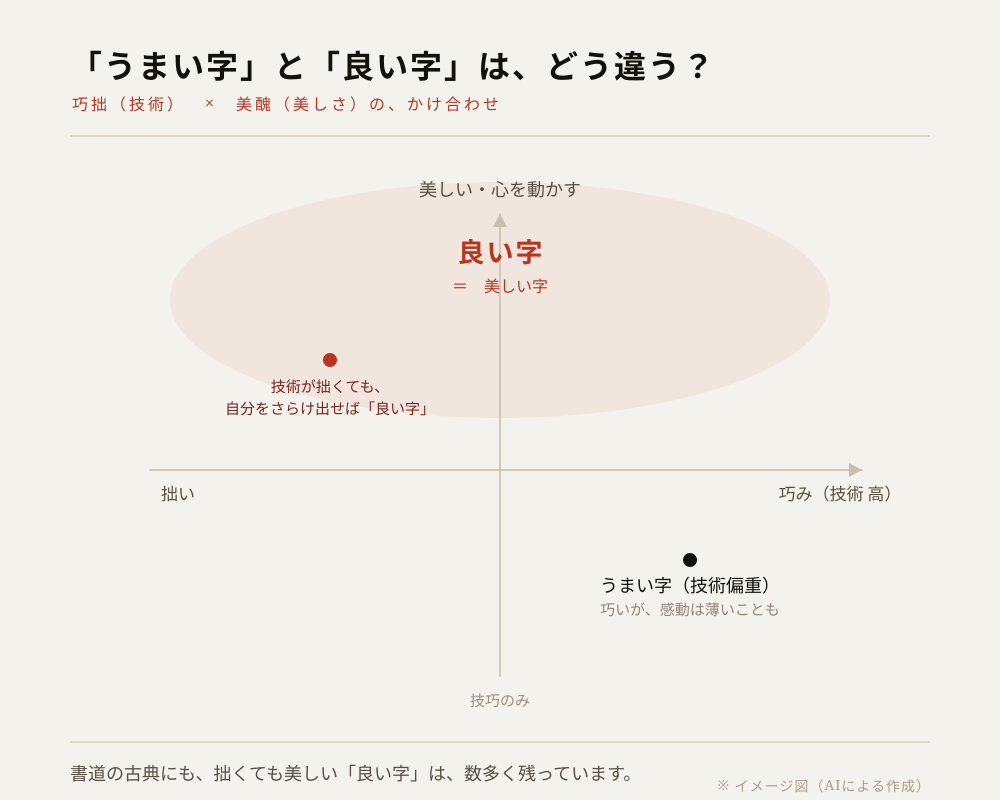
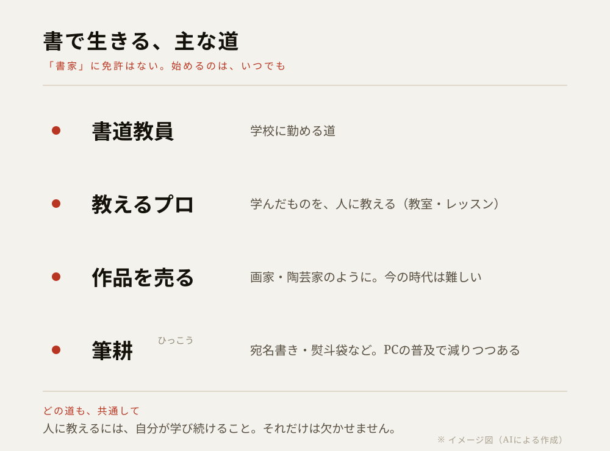
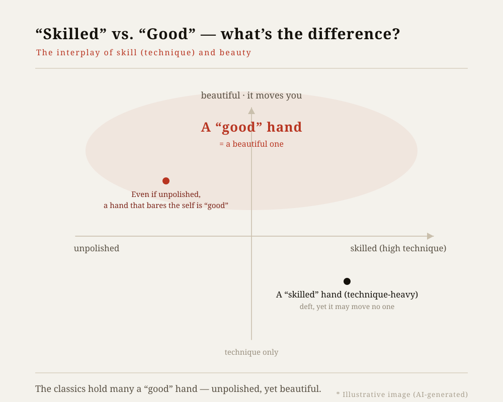
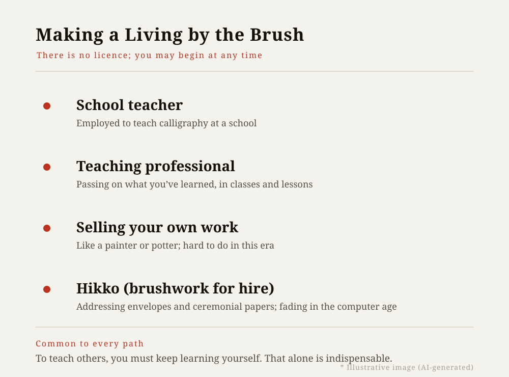

title_ja: "書家・日賀野 琢に聞く　「良い字」、古代文字、そして書で生きること"
title_en: "Taku Higano in Conversation: On a “Good” Hand, the Ancient Scripts, and Living by the Brush"
category_ja: インタビュー
category_en: Interview
date: '2026-11-28'
eyecatch: /assets/img_b7f922aafcbb.jpg
author: taku
style: qa
featured: true
order: 2
excerpt_ja: "「良い字」とは何か、なぜ古代文字に惹かれるのか、そして書道家として生きるとは。臥龍会 三代目・日賀野 琢が、自らの言葉で率直に語ります。"
excerpt_en: "What makes a hand truly good, why a calligrapher is drawn to the ancient scripts, and what it means to live by the brush — Taku Higano, third-generation head of Garyukai, speaks candidly."
desc_ja: "書家・日賀野 琢へのインタビュー。「うまい字」と「良い字」の違い、篆書・隷書など古代文字の魅力、そして「書道家になるには」という問いまで、臥龍会 三代目が率直に語ります。"
desc_en: "An interview with calligrapher Taku Higano: the difference between a skilled and a good hand, the allure of the ancient seal and clerical scripts, and how one becomes a calligrapher — answered candidly by the third-generation head of Garyukai."
answer_ja: "「書道家」に免許は要りません。やりたいと思えば、いつでも始められます。ただし人に教えるには、自分も学び続けること——そこだけは欠かせません。"
answer_en: "There is no licence to become a calligrapher — if you wish to, you may begin at any time. But to teach others, you must keep learning yourself; that alone is indispensable."
faq_ja:
  - q: "書道家になるにはどうすればいいですか？"
    a: "免許は要りません。「自分は書家だ」と名乗り、学び続けること。やりたいと思えばいつでも始められます。ただし人に教えるには、自分も学び続けることが欠かせません。"
  - q: "「うまい字」と「良い字」はどう違いますか？"
    a: "うまい字は技術が巧みな字、良い字は技術が拙くても自分をさらけ出した美しい字です。巧拙（技術）と美醜（美しさ）の掛け合わせで考えます。"
  - q: "書道で生計を立てられますか？"
    a: "容易ではありません。学校の書道教員になる道と、教室・レッスンのプロになる道が主で、作品販売や筆耕だけで生きるのは今の時代とても難しいのが実情です。"
faq_en:
  - q: "How do you become a calligrapher?"
    a: "No licence is required. You declare yourself a calligrapher and keep learning; if you wish to begin, you may start at any time. To teach others, though, you must keep studying yourself."
  - q: "What is the difference between a skilled hand and a good hand?"
    a: "A skilled hand is technically deft; a good hand is beautiful even when unpolished, because it lays the self bare. Think of it as the interplay of skill and beauty."
  - q: "Can you make a living from calligraphy?"
    a: "It is not easy. The main paths are teaching in schools or becoming a professional at lessons; living by selling your own work or by brush-work for hire alone is very hard today."
body_ja: |
  ## 「上手い字」と「良い字」は、何が違うと考えますか。

  よく言われることですが、「うまい字」と「良い字」は、巧拙（巧み・拙い）と美醜（美しい・醜い）の掛け合わせで考えます。書家の字は巧いけれど技術偏重で、あまり人に感動を与えないことがある。一方で、たとえ拙くても美しいのが「良い字」。たとえば障害のある方が書く字は、技術的には拙なくても、考えずに自分をさらけ出していて、そこにこそ良さがある。書道の古典にも、そういうものはたくさんあります。

  

  ## 専門の古代文字（篆書・隷書）に惹かれた理由は。

  もともと最初の先生が楷書の先生で、北魏時代の力強い楷書（造像記など）をずっと書いていました。ただ私は小さい頃からの流れで、どちらかというと行書・草書のほうが向いていて、楷書を書いていても皆と少し雰囲気が違った。その後、伊藤先生が篆書を手掛け始め、「篆書って面白いな」と。大学時代は篆書がまったく分からなかったのですが、先生が亡くなり、今の新井先生のところへ行ったら篆書の専門家で、最初から篆書を習いました。入門したての頃「篆書でやりたい」と言ったら「10年かかる」と言われたのを今でも覚えています。必死に字書を買い、調べ、臨書して、だんだんハマっていきました。篆書・隷書＝古代文字は、時代は古いのに現代的な要素を持っている。文字が生まれた頃の姿は神秘的で、知れば知るほど、書けば書くほど興味が尽きません。今は外国の方に教えるときの格好の題材にもなっています。

  ## 「書道家になるには」何から始めるべきだと思いますか。

  「書道家」の定義自体が難しいものです。伊藤先生が大学の授業で「書家になるにはどうしたらいい?」と皆に問いかけたとき、ある学生が「日展に入ることです」と答えたら、「バカモン、自分が書家だと名乗ればいいんだ」と言われた——それを今でも覚えています。医師のように免許が要るわけではないので、やりたいと思えばいつでも始められる。今はSNSで発信する子どもや若い人もたくさんいるので、こだわりすぎる必要はありません。ただし人に教えるには、自分も学び続けなければならない。そこだけは欠かせません。

  ## 書道家として生計を立てるには、どんな道がありますか。

  シビアな質問ですが、書道で飯を食うのは今の時代なかなか厳しい。私自身も、教えてきた若い学生たちもそうでした。一つは、書道の教員になって学校に勤める道。それ以外は、自分が得たものを人に教える「レッスンのプロ」になること。画家や彫刻家、陶芸家のように自分の作品を売って生計を立てるのは、今の時代なかなか難しい。かつては筆耕（宛名書きや熨斗袋書きなど）の仕事もありましたが、パソコンの時代でそれも減りつつあります。書道で食べていくのは、本当に厳しいです。

  
body_en: |
  ## What is the difference between a “skilled” hand and a “good” hand in calligraphy?

  It is often said, and I think of it as the interplay of skill (deft or clumsy) and beauty (beautiful or plain). A calligrapher’s hand may be deft yet so weighted toward technique that it moves no one. A “good” hand, by contrast, is beautiful even when unpolished. To give a recent example, the characters written by a person with a disability can be technically unrefined, yet they lay the self utterly bare — and there lies their goodness. The classics of calligraphy hold a great many works of exactly this kind.

  

  ## Why were you drawn to the ancient scripts — seal script (tensho) and clerical script (reisho)?

  My first teacher was a teacher of standard script (kaisho), and I long wrote the powerful kaisho of the Northern Wei — the votive inscriptions. Yet by my inclination since childhood I leaned toward semi-cursive and cursive, and even in kaisho my air differed a little from everyone else’s. Later, Mr. Ito began to take up seal script (tensho), and I thought, “how fascinating.” At university I had not understood tensho at all; but when he passed and I went to Arai-sensei, he was a specialist, and I learned seal script from the very start. I still remember, newly enrolled, saying “I want to work in tensho,” and being told, “that will take ten years.” I bought character dictionaries, researched, copied — and was gradually drawn in. Seal and clerical script — the ancient characters — are old in age yet carry something contemporary. The form of a character at its birth is profoundly mysterious; the more I know it, the more I write it, the more inexhaustible my fascination. It has also become the perfect subject when teaching guests from abroad.

  ## If someone wishes to become a calligrapher, where should they begin?

  Even the word “calligrapher” is hard to define. I still remember Mr. Ito posing it to our university class: “How does one become a calligrapher?” When a student answered, “By getting into Nitten,” he thundered, “Fool — you become one by declaring yourself a calligrapher.” There is no licence required, as there is for a physician; if you wish to, you may begin at any time. Today many children and young people share their work on social media, so there is no need to overthink it. Yet to teach others, you must keep learning yourself — that alone is indispensable.

  ## What are the realistic paths to making a living as a calligrapher?

  It is a hard truth, but to live by calligraphy is difficult in this age — as it was for me, and for the young students I have taught. One path is to become a calligraphy teacher employed by a school. Otherwise, it is to become a professional at teaching what one has gained — a master of lessons. To live, as a painter or sculptor or potter might, by creating and selling one’s own works alone is, in this era, very hard for a calligrapher. There was once the craft of hikko — brush-work for hire, addressing envelopes and inscribing ceremonial envelopes — but in the age of the computer even that is fading. Truly, to make a living by calligraphy is severe.

  
